<div align="center">

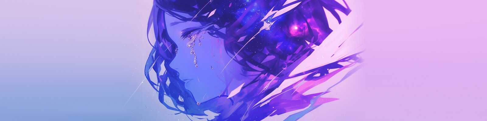

# Ninomae

**A Fedora + Hyprland desktop that colours itself from your wallpaper.**

A custom [Quickshell](https://quickshell.org) shell in a Material 3 style, with a game launcher,
gameplay clips and live settings. Change the wallpaper and everything follows.


[Screenshots](#screenshots) · [Install](#install) · [Using it](#using-it) · [Keybinds](#keybinds) · [Colours](#wallpaper-and-colours) · [Gaming](#gaming) · [Layout](#where-things-are) · [Help](#troubleshooting)

</div>

<br>

## Highlights

|  |  |
|---|---|
| 🎨 **Wallpaper theming** | One wallpaper recolours the shell, borders, cursor, folder icons, terminal, Steam, Discord, VS Code and the login screen. Video wallpapers work too. |
| 🎮 **Game launcher** | Steam and Lutris games with cover art, launch progress, captures and per-game launch options. |
| 🎬 **Gameplay clips** | Press `` ` `` in a game to save the last minute, with game audio, voice chat and your mic. |
| 🎯 **Crosshair** | Your own crosshair over the games you pick, drawn part by part with a live preview. |
| 🕹️ **In-game overlay** | `Super+Shift+G` in a game: clips, screenshots, performance and each app's volume without leaving it. |
| ⚙️ **Live settings** | Every option in one searchable window, applied the moment you change it. |
| 💻 **One folder, many machines** | The same setup on a desktop and a laptop. Hardware you don't have is hidden. |

<br>

## Screenshots

<div align="center">

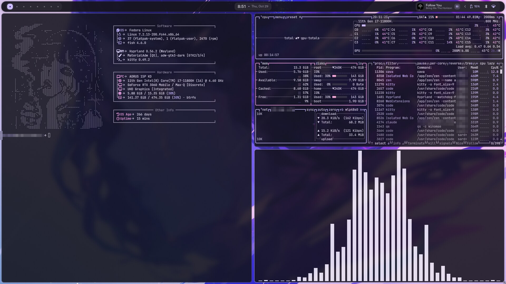

<sub><b>Desktop</b> · the terminal, borders and bar all take their colours from the wallpaper</sub>

<br><br>

<table>
<tr>
<td width="50%" align="center">
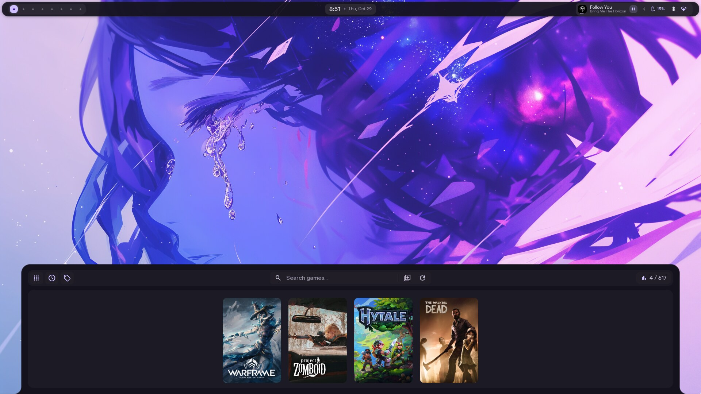<br>
<sub><b>Game launcher</b> · Steam and Lutris games with cover art</sub>
</td>
<td width="50%" align="center">
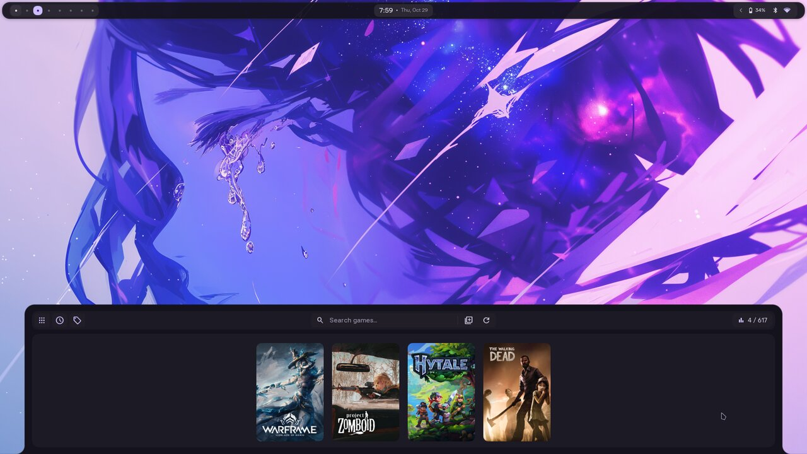<br>
<sub><b>Game page</b> · news, captures, ProtonDB and playtime</sub>
</td>
</tr>
</table>

<br>

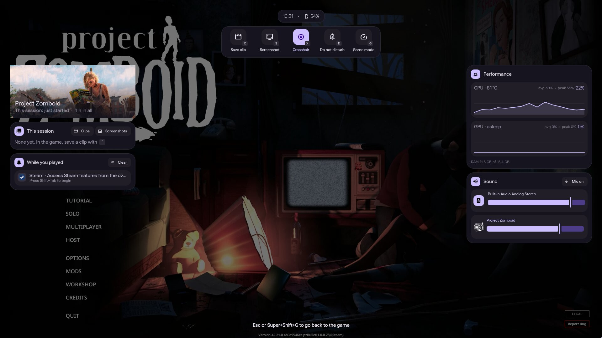

<sub><b>In-game overlay</b> · <code>Super+Shift+G</code> in a game: clips, screenshots, performance and sound without leaving it</sub>

<br><br>

<table>
<tr>
<td width="50%" align="center">
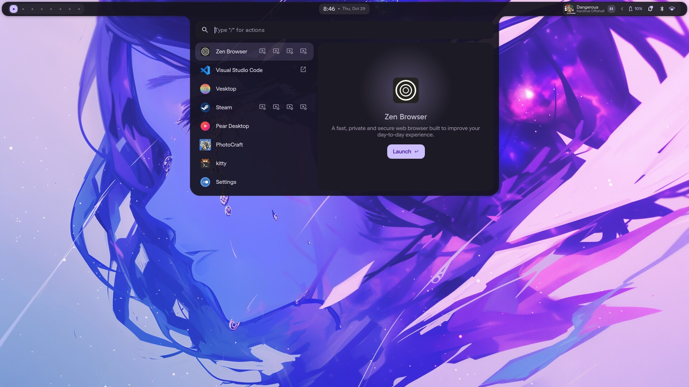<br>
<sub><b>Overview</b> · apps, clipboard, emoji, web search</sub>
</td>
<td width="50%" align="center">
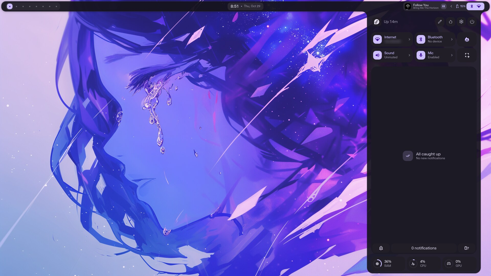<br>
<sub><b>Sidebar</b> · toggles, notifications, system stats</sub>
</td>
</tr>
<tr>
<td width="50%" align="center">
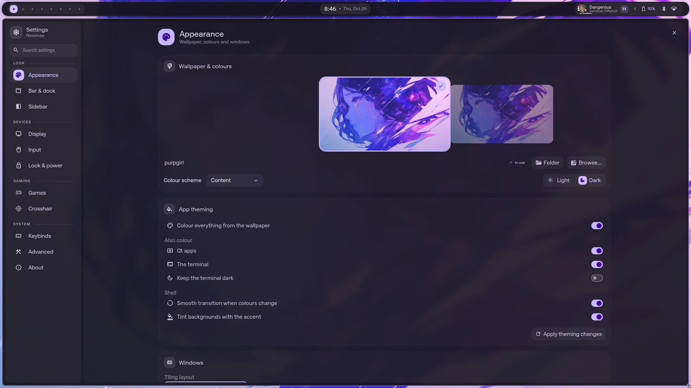<br>
<sub><b>Settings</b> · every option, applied live</sub>
</td>
<td width="50%" align="center">
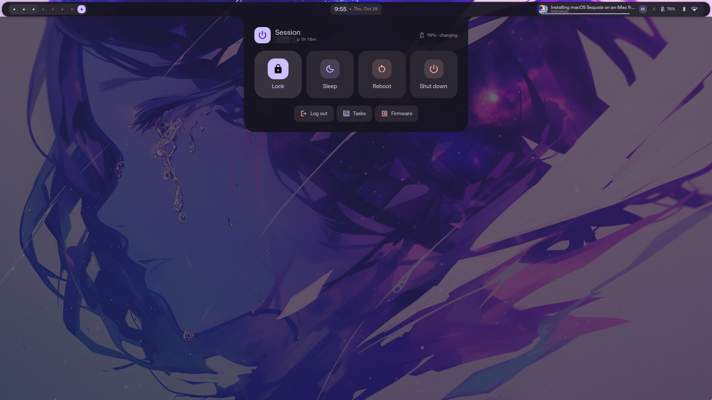<br>
<sub><b>Power menu</b> · a countdown before anything closes your apps</sub>
</td>
</tr>
<tr>
<td width="50%" align="center">
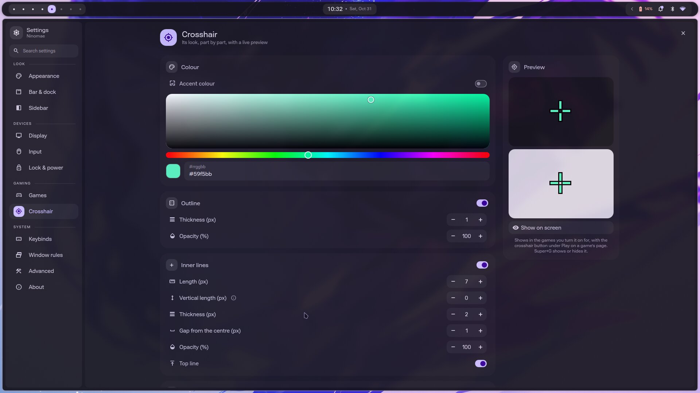<br>
<sub><b>Crosshair</b> · built part by part, previewed live</sub>
</td>
<td width="50%" align="center">
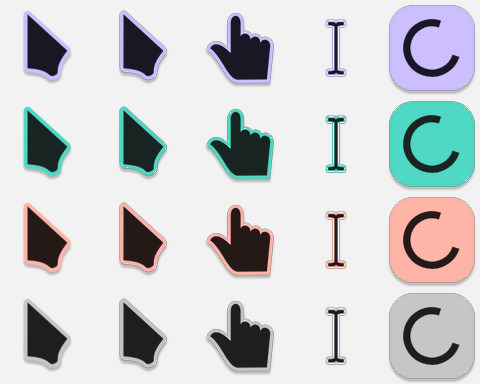<br>
<sub><b>Cursor</b> · takes the wallpaper's accent, like the folder icons</sub>
</td>
</tr>
</table>

</div>

<br>

## Install

```sh
git clone https://github.com/Doctoena/Ninomae-Shell.git ~/Ninomae-Shell
cd ~/Ninomae-Shell
./install.sh
```

The installer shows a checklist of what to set up and asks for your keyboard layout (any layout:
it offers the one this computer uses now). When it's done, reboot and pick the **Hyprland** session on the login screen. A welcome
window then walks you through the look, the window layout, your weather location and the gaming
features.

> [!NOTE]
> - Anything it replaces is backed up to `~/.dotfiles-backup-<date>`.
> - The folder has to live at `~/Ninomae-Shell`. If you cloned it somewhere else, the installer moves it.
> - It's safe to run again. It only changes what isn't set up yet.

**Multimedia codecs** are on by default. They turn on [RPM Fusion](https://rpmfusion.org) for the
full ffmpeg and video drivers, which gameplay clips need on AMD graphics and which make video faster
everywhere. Skip them with `--skip codecs`.

### Keeping it up to date

```sh
ninomae update   # the latest version: new packages, rebuilt plugins, then a shell restart
ninomae check    # is everything in place? (changes nothing)
```

Not using fish? `./install.sh --update` and `./install.sh --check` do the same.

> [!TIP]
> Updates never touch your settings. `config.json` isn't in git, and your weather city is kept
> outside the folder. A new install starts from `config.default.json`.

### Steam and Zen

They're themed once they've been opened for the first time. Zen is themed by itself. For Steam, open it
once, sign in and close it: a notification offers to theme it (it asks for your password in a terminal).
Turned it down? Run `themes/steam/install-theme.sh` any time.

<details>
<summary><b>Installer options</b>: update, uninstall, pick components</summary>

<br>

| Option | What it does |
|---|---|
| `--update` | Get the latest files, packages and plugins (`ninomae update`) |
| `--check` | See if everything is in place, without changing anything (`ninomae check`) |
| `--uninstall` | Remove the links and restore your backups (packages and this folder stay) |
| `--dry-run` | Show what would happen without changing anything |
| `-y` | Don't ask questions, use the defaults |
| `--only a,b` / `--skip a,b` | Pick components: `packages` `codecs` `configs` `shell` `apps` `steam` `sddm` `boot` `fish` |
| `--boot` | Also install the boot splash (off by default) |
| `--keyboard LAYOUT` | Set the layout without asking: `us`, `de`, `fr`, `us:dvorak`, `de:nodeadkeys`… |

</details>

<br>

## Using it

| | Open with | What's in it |
|---|---|---|
| **Bar** | Always on top | Click the clock, battery, media or tray icons to open their drawers |
| **Sidebar** | `Super+O` | Quick toggles, notifications and system stats. Click CPU or RAM to see the apps using the most, and end one |
| **Overview** | `Super+E` | Launch apps and search |
| **Game launcher** | `Super+Shift+O` | Your Steam and Lutris games |
| **In-game overlay** | `Super+Shift+G` | Only while a game runs: clips, screenshots, the crosshair, performance and sound |
| **Screenshot** | `Super+Shift+A` | A region, window or the whole screen: save and copy, draw on it, search the web for it or copy its text |
| **Settings** | `Super+I` | Every option, applied live. Also your own shortcuts and window rules |
| **Lock** | `Super+L` | Also locks by itself after 5 minutes |
| **Power menu** | `Ctrl+Alt+Delete` | Lock, sleep, reboot, shut down. Reboot and shut down count down for 5 seconds first, and apps are asked to close so they can save |

### Searching in the overview

Start with a symbol to search one thing:

| Prefix | Searches | | Prefix | Searches |
|:---:|---|---|:---:|---|
| `>` | Apps | | `=` | Calculator |
| `;` | Clipboard (last 300 copies, newest 40 images) | | `$` | Run a shell command |
| `:` | Emoji | | `?` | The web |
| `/` | Actions, like `/wallpaper` | | | |

Typing `settings` also finds **Ninomae Settings**, above other apps.

<br>

## Keybinds

`Super+/` opens the full, searchable list, where **Edit** changes a shortcut's keys, turns one off or adds
your own. These are the ones you'll use most.

<table>
<tr><th>Apps and windows</th><th>Workspaces and desktop</th></tr>
<tr valign="top"><td>

| Keys | Action |
|---|---|
| `Super+Return` | Terminal |
| `Super+P` | File manager |
| `Super+C` | Code editor |
| `Super+V` | Clipboard history |
| `Super+.` | Emoji picker |
| `Super+Q` | Close window |
| `Super+F` | Fullscreen |
| `Super+D` | Maximise |
| `Super+Shift+Space` | Float or tile |

</td><td>

| Keys | Action |
|---|---|
| `Super+1` … `0` | Go to workspace |
| `Super+Shift+1` … `0` | Move window there |
| `Super+S` | Scratchpad |
| `Super+J` | Show or hide the bar |
| `Super+Shift+C` | Colour picker |
| `Super+-` / `Super+=` | Zoom out / in |
| `` ` `` | Save a gameplay clip |
| `Super+G` | Show or hide the crosshair |
| `Super+Shift+G` | In-game overlay |
| `Super+Shift+L` | Sleep |
| `Super+Ctrl+R` | Restart the shell |

</td></tr>
</table>

> [!TIP]
> The letters are for **US Dvorak**. On any other layout each shortcut stays on the same *physical* key, so
> lock (`Super+L`) becomes `Super+P`. The list in Settings always shows the keys as your layout prints them.
> Change the layout in **Settings → Input**.

<br>

## Wallpaper and colours

Change the wallpaper in **Settings → Appearance** or type `/wallpaper` in the overview. The whole
desktop recolours to match, with colours made by [matugen](https://github.com/InioX/matugen).

| When | What updates |
|---|---|
| **Straight away** | The shell, window borders, the cursor, folder icons, kitty, Steam, Discord (Vesktop), VS Code, the login screen |
| **Next time you open them** | GTK and Qt apps, Zen |
| **When you run** `sudo themes/boot/install-boot-theme.sh` | The boot splash |

**Ultrawide and other shapes.** Put a version made for another screen shape next to the wallpaper,
named with its size, like `purpgirl_5120x1440.png` beside `purpgirl.png`. Each screen then shows
the version closest to its shape, and the pickers show the pair as one wallpaper.

<br>

## Gaming

- **Game launcher.** Your games with cover art. Steam and SteamGridDB API keys are optional and get
  better art. Add them in **Settings → Games**. They're kept in your keyring, not in this folder.
- **Launching.** A drawer under the bar shows what Steam is doing (updating, compiling shaders…)
  until the game opens.
- **Launch options.** On a game's page, **… → Launch options** turns GameMode, MangoHud and
  gamescope (with its resolution and refresh rate) on or off, and picks the Proton version and how
  the game updates. Steam uses the same settings.
- **Customize.** **… → Customize** changes a game's background, cover and logo (from SteamGridDB or
  a file) and its particle effect, with a preview: hover one to see it before you pick it.
- **Clips.** While a game runs, `` ` `` saves the last minute to `~/Videos/Clips/<game>/`. Nothing
  records outside games, or while Steam is only updating one. Change the key and length, or turn it off,
  in **Settings → Games**.
- **In-game overlay.** `Super+Shift+G` while a game runs (it closes if the game does): the time and battery
  the hidden bar would show, quick actions with a letter key each (save a clip, screenshot, crosshair, do not
  disturb, game mode), the game's art and hours, this session's clips and screenshots (one opens right
  there: clips play with a seek bar, `Shift+←/→` skips 5 s, `Ctrl+C` copies), what came in while you played, live CPU and GPU graphs,
  and the sound: output device, mic, and each app's volume, the game's own first. Turn it off in
  **Settings → Games**.
- **GE-Proton.** **Settings → Games** installs the latest GE-Proton in one click (checked before it's
  unpacked) and removes old versions no game uses.
- **Crosshair.** Design one in **Settings → Crosshair**, then turn it on per game with the crosshair
  button under Play on its page. `Super+G` shows or hides it.
- **Captures.** Each game's page shows its screenshots (Steam's F12 and the game's own folder) and
  clips. Clips play right there. `T` trims one into a new clip, and `Ctrl+C` copies it, ready to
  paste into Discord. With an Immich server set in **Settings → Games**, the cloud button backs
  them up to an album named after the game.
- **Game mode.** A sidebar toggle that turns off animations, blur and gaps for more performance.
- **Steam theme.** [Millennium](https://github.com/SteamClientHomebrew/Millennium) with
  [Material-Theme](https://github.com/kuska1/Material-Theme). A Steam update can break it for a day
  or two.

<br>

## More than one computer

The same folder works on a desktop and a laptop.

- Screens set themselves up: each one starts at its best resolution and refresh rate. Change one in
  **Settings → Display**, where you can also drag screens into place, turn one off or mirror another.
  Settings are remembered per monitor, so a monitor keeps them on any computer you plug it into.
- Settings for hardware a machine doesn't have are hidden: battery options only on a laptop,
  touchpad options only with a touchpad.
- Each machine keeps its own settings, since `config.json` isn't in git. `ninomae update` on one
  machine never changes the other's settings.

<br>

## Where things are

```text
~/Ninomae-Shell
├── install.sh, setup/          the installer
├── config/                     app configs, linked into ~/.config
│   ├── hypr/                   Hyprland
│   ├── matugen/                colour templates
│   ├── ninomae-shell/          config.default.json, copied to config.json (your settings, not in git)
│   └── quickshell/
│       ├── Ninomae/            the shell
│       └── plugins/            ninomae-blobs, the gooey drawer animation
├── themes/                     login screen, boot splash, Steam, Zen, Discord, VS Code
└── assets/                     fonts, icons, cursors, wallpapers
```

<details>
<summary><b>Inside the shell</b></summary>

<br>

In `config/quickshell/Ninomae/`:

| Path | What's there |
|---|---|
| `modules/` | Everything on screen: bar, sidebar, overview, lock screen, game launcher, settings pages… |
| `modules/common/Config.qml` | Every option and its default |
| `modules/common/Appearance.qml` | Sizes, fonts and colours |
| `services/` | Audio, network, notifications, weather, games… |
| `scripts/colors/switchwall.sh` | Applies a new wallpaper and its colours |

The blob plugin is compiled and rebuilds itself after Qt updates. Until it has, the drawers are
plain.

</details>

<br>

## Troubleshooting

| Problem | Fix |
|---|---|
| Not sure what's wrong | `ninomae check` looks over the whole setup and says what to fix |
| The shell is stuck or looks wrong | `Super+Ctrl+R` restarts it |
| Something isn't working | `qs log -c Ninomae` shows the shell's log |
| A setup step failed | `ninomae update`, or run `./install.sh` again |
| Colours didn't update | **Settings → Appearance → Apply theming changes** |

<br>

<div align="center">

Built on [illogical-impulse](https://github.com/end-4/dots-hyprland) by end-4, with ideas from
[Caelestia](https://github.com/caelestia-dots/shell).

Licensed under the [GNU GPL v3](LICENSE). Wallpapers belong to their artists.

</div>
