<div align="center">

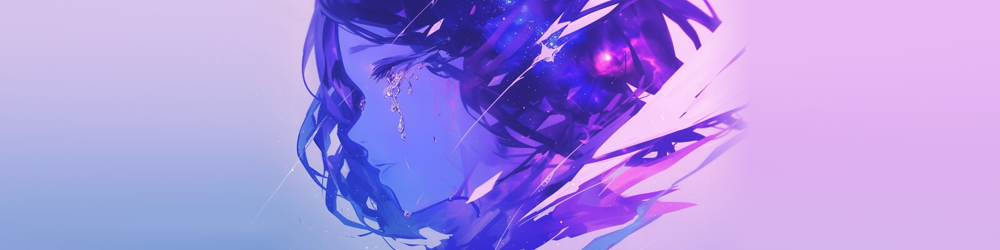

# Ninomae

**A Fedora + Hyprland desktop that colours itself from your wallpaper.**

A custom glass [Quickshell](https://quickshell.org) shell, a game launcher that can stand in for Steam's library,
and one script that sets it all up. Change the wallpaper and everything follows.


[Screenshots](#screenshots) · [Install](#install) · [Using it](#using-it) · [Keybinds](#keybinds) · [Colours](#wallpaper-and-colours) · [Gaming](#gaming) · [Layout](#where-things-are) · [Help](#troubleshooting)

</div>

<br>

## Highlights

|  |  |
|---|---|
| 🎨 **Wallpaper theming** | One wallpaper recolours the shell, window borders, cursor, folder icons, terminal, Steam, Discord, VS Code and the login screen. Video wallpapers work too. |
| 🪟 **Glass shell** | Bar, sidebar, drawers and windows in frosted glass, lit by the accent. Turn the glass off and the same design goes solid. |
| 🎮 **Game launcher** | Steam, Lutris and games you add, with cover art, news, achievements, captures, stats and launch options. |
| 🕹️ **In-game overlay** | `Super+Shift+G` in a game: clips, screenshots, FPS, performance and each app's volume without leaving it. |
| 🎬 **Gameplay clips** | Press `` ` `` in a game to save the last minute, with game audio, voice chat and your mic. |
| 🎯 **Crosshair** | Your own crosshair over the games you pick, built part by part with a live preview. |
| ⚙️ **Live settings** | Every option in one searchable window, applied the moment you change it. |
| 💻 **One folder, many machines** | The same setup on a desktop and a laptop. Hardware you don't have is hidden. |

<br>

## Screenshots

<div align="center">

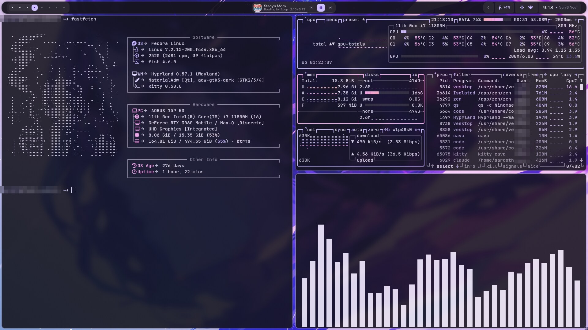

<sub><b>Desktop</b> · the terminal, borders and bar all take their colours from the wallpaper</sub>

<br><br>

<table>
<tr>
<td width="50%" align="center">
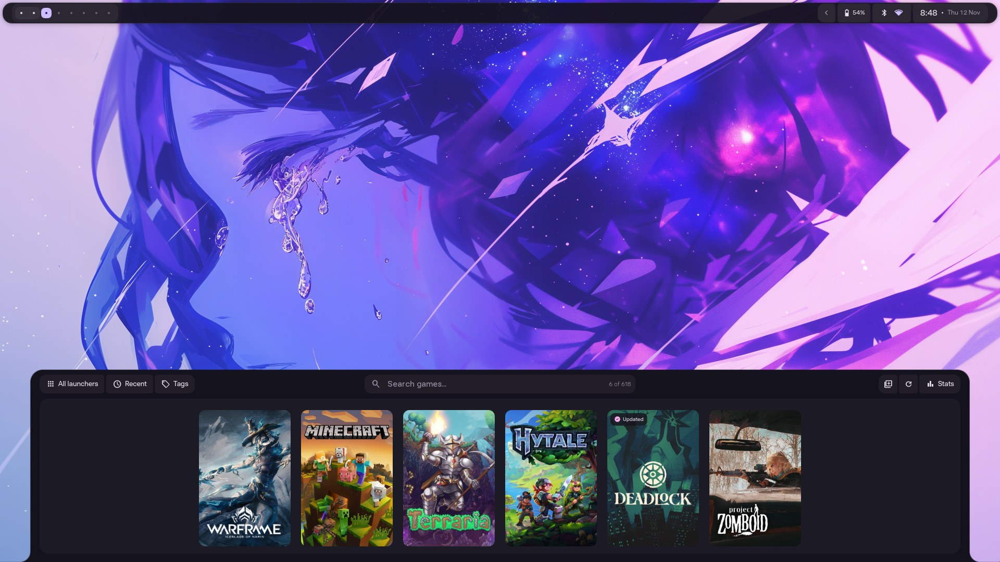<br>
<sub><b>Game launcher</b> · Steam, Lutris and games you add</sub>
</td>
<td width="50%" align="center">
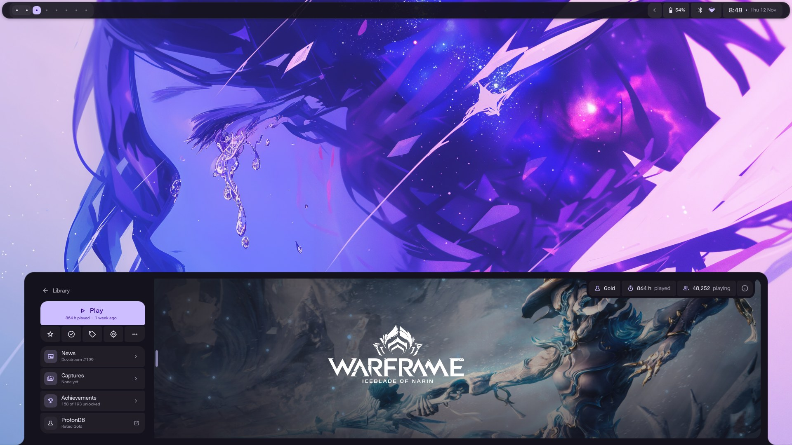<br>
<sub><b>Game page</b> · news, captures, achievements and ProtonDB</sub>
</td>
</tr>
<tr>
<td width="50%" align="center">
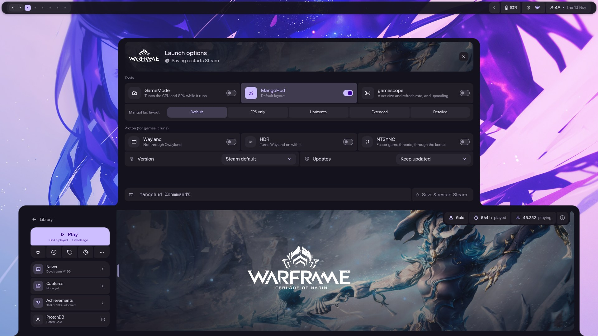<br>
<sub><b>Launch options</b> · GameMode, MangoHud, gamescope and Proton, written into Steam</sub>
</td>
<td width="50%" align="center">
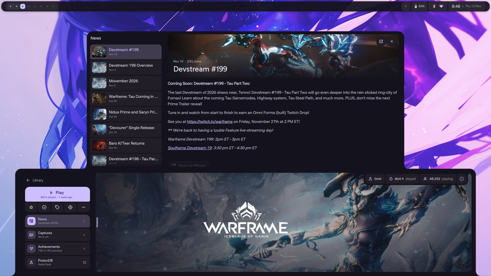<br>
<sub><b>News</b> · announcements and patch notes, new posts marked</sub>
</td>
</tr>
<tr>
<td colspan="2" align="center">
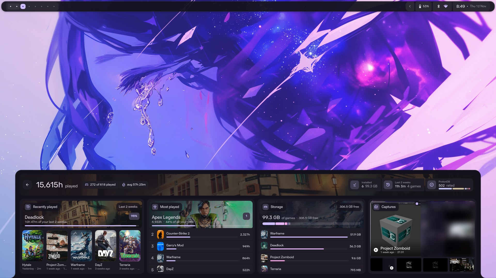<br>
<sub><b>Stats</b> · your hours, what you've played lately and most, what's taking the space</sub>
</td>
</tr>
</table>

<br>

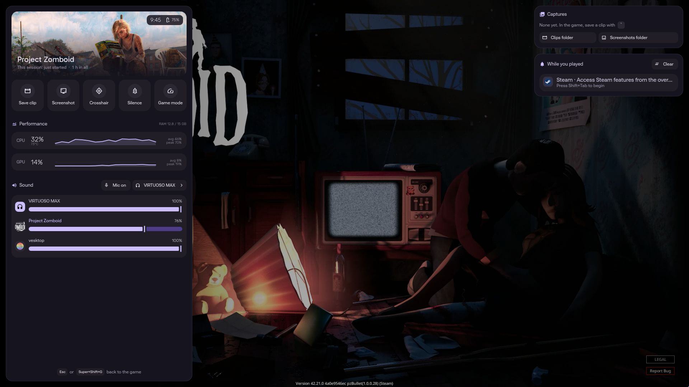

<sub><b>In-game overlay</b> · clips, screenshots, FPS, performance and sound without leaving the game</sub>

<br><br>

<table>
<tr>
<td width="50%" align="center">
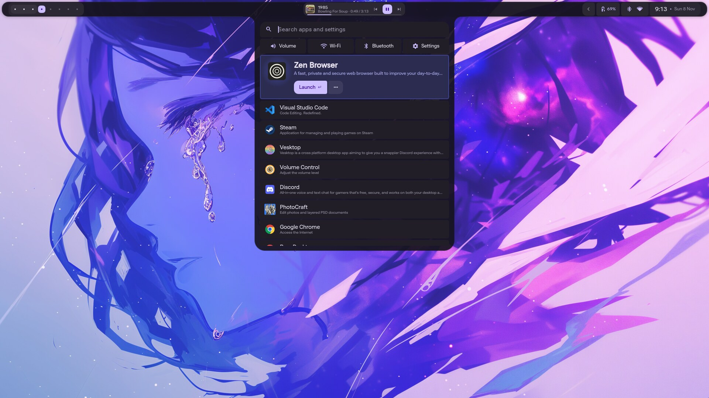<br>
<sub><b>App search</b> · apps, settings pages, clipboard, emoji, maths, web</sub>
</td>
<td width="50%" align="center">
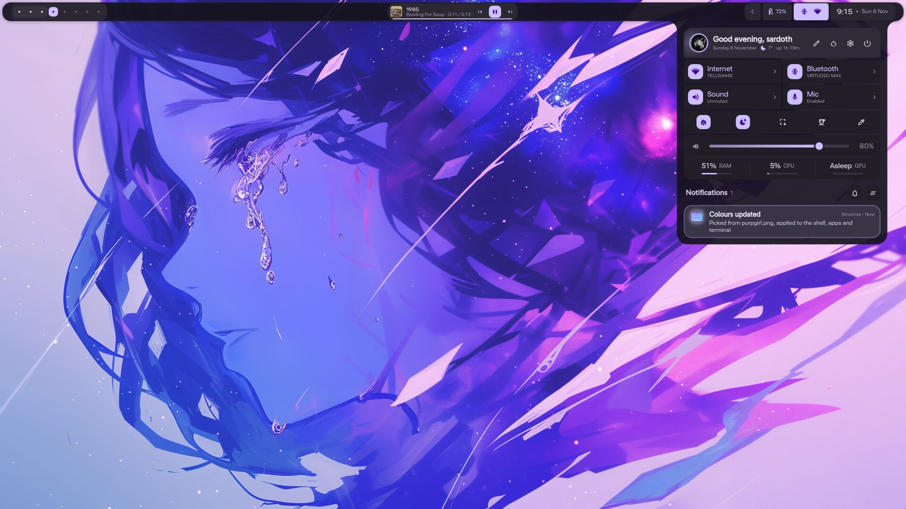<br>
<sub><b>Sidebar</b> · toggles, sound, system stats, notifications</sub>
</td>
</tr>
<tr>
<td width="50%" align="center">
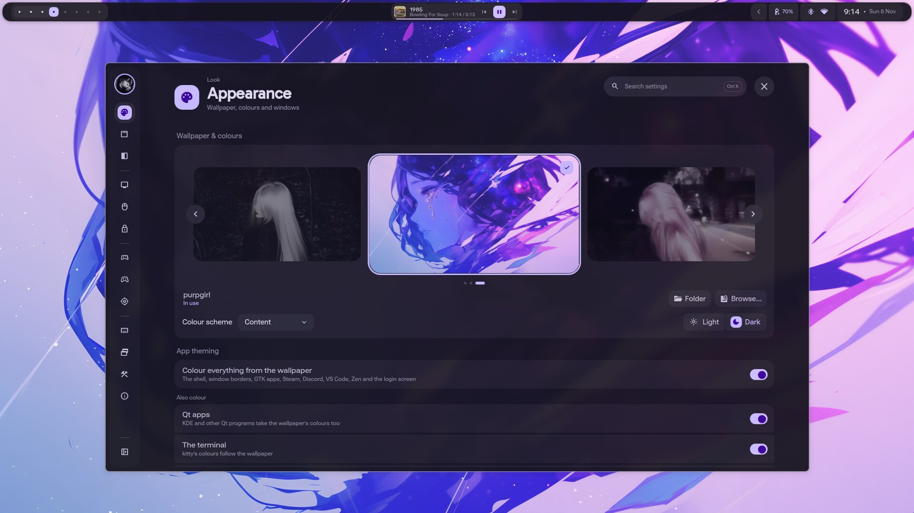<br>
<sub><b>Settings</b> · every option, applied live</sub>
</td>
<td width="50%" align="center">
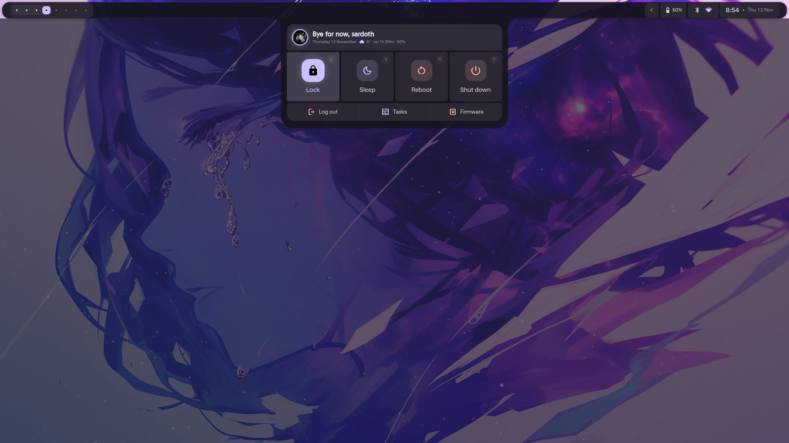<br>
<sub><b>Power menu</b> · a countdown before anything closes your apps</sub>
</td>
</tr>
<tr>
<td width="50%" align="center">
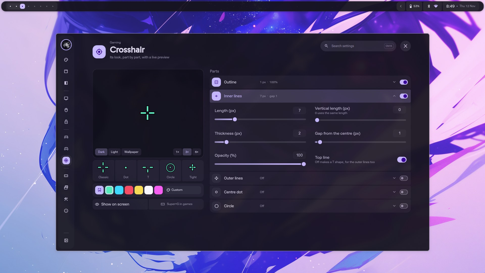<br>
<sub><b>Crosshair</b> · start from a style, tune each part</sub>
</td>
<td width="50%" align="center">
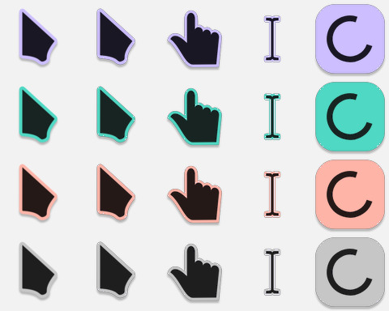<br>
<sub><b>Cursor</b> · takes the wallpaper's accent, like the folder icons</sub>
</td>
</tr>
<tr>
<td width="50%" align="center">
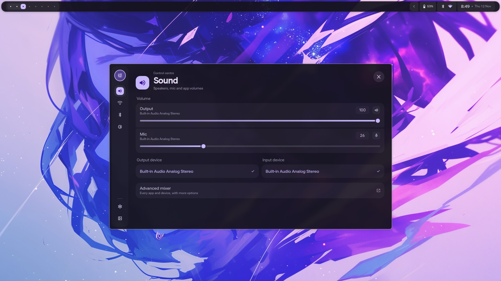<br>
<sub><b>Control centre</b> · sound, Wi-Fi, Bluetooth and display in one window</sub>
</td>
<td width="50%" align="center">
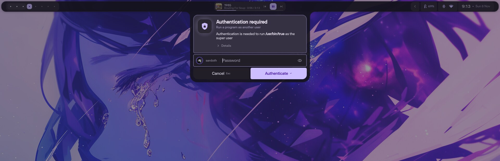<br>
<sub><b>Password prompt</b> · says what's asking and why, warns about Caps Lock</sub>
</td>
</tr>
<tr>
<td colspan="2" align="center">
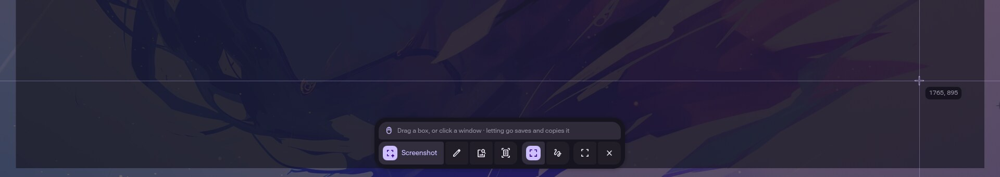<br>
<sub><b>Area picker</b> · screenshot it, draw on it, search it or copy its text</sub>
</td>
</tr>
</table>

</div>

<br>

## Install

```sh
git clone https://github.com/Doctoena/Ninomae-Shell.git ~/Ninomae-Shell
cd ~/Ninomae-Shell
./install.sh
```

The installer shows a checklist of what to set up and asks for your keyboard layout, offering the one
this computer uses now. Then reboot and pick the **Hyprland** session on the login screen. A welcome
window walks you through the look, the window layout, your weather location and the gaming features.

> [!NOTE]
> - Anything it replaces is backed up to `~/.dotfiles-backup-<date>`.
> - The folder has to live at `~/Ninomae-Shell`. Cloned somewhere else? The installer moves it.
> - It's safe to run again. It only changes what isn't set up yet.

**Multimedia codecs** are on by default. They turn on [RPM Fusion](https://rpmfusion.org) for the full
ffmpeg and video drivers, which gameplay clips need on AMD graphics. Skip them with `--skip codecs`.

**Steam and Zen** are themed once they've been opened for the first time. Zen themes itself. For Steam,
open it once, sign in and close it, and a notification offers to theme it. Turned it down? Run
`themes/steam/install-theme.sh` any time.

### Keeping it up to date

```sh
ninomae update   # new files, packages and plugins, then a shell restart
ninomae check    # is everything in place? (changes nothing)
```

Not using fish? `./install.sh --update` and `./install.sh --check` do the same. Updates never touch your
settings: `config.json` isn't in git, and your weather city is kept outside the folder.

<details>
<summary><b>Installer options</b></summary>

<br>

| Option | What it does |
|---|---|
| `--update` / `--check` | The same as `ninomae update` / `ninomae check` |
| `--uninstall` | Remove the links and restore your backups (packages and this folder stay) |
| `--dry-run` | Show what would happen without changing anything |
| `-y` | Don't ask, use the defaults |
| `--only a,b` / `--skip a,b` | Pick components: `packages` `codecs` `configs` `shell` `apps` `steam` `music` `sddm` `boot` `fish` |
| `--boot` | Also install the boot splash (off by default) |
| `--music` | Also install YouTube Music, the [Pear Desktop](https://github.com/pear-devs/pear-desktop) app themed with your wallpaper (off by default) |
| `--keyboard LAYOUT` | Set the layout without asking: `us`, `de`, `fr`, `us:dvorak`, `de:nodeadkeys`… |

</details>

<br>

## Using it

| | Open with | What's in it |
|---|---|---|
| **Bar** | Always there | Workspaces, what's playing, the tray, battery, status and clock. Each opens its own drawer |
| **Sidebar** | `Super+O` | Quick toggles, sound, notifications and system stats. Click CPU or RAM for the apps using the most, and end one |
| **App search** | `Super+E` | Launch apps and search |
| **Game launcher** | `Super+Shift+O` | Your Steam, Lutris and added games |
| **In-game overlay** | `Super+Shift+G` | While a game runs: clips, screenshots, the crosshair, performance and sound |
| **Screenshot** | `Super+Shift+A` | A region, window or the whole screen. Save and copy it, draw on it, search the web for it or copy its text |
| **Settings** | `Super+I` | Every option, applied live, plus your own shortcuts and window rules |
| **Lock** | `Super+L` | Also locks by itself after 5 minutes |
| **Power menu** | `Ctrl+Alt+Delete` | Reboot and shut down count down for 5 seconds, and apps are asked to close so they can save |

Start a search with a symbol to search one thing:

| Prefix | Searches | | Prefix | Searches |
|:---:|---|---|:---:|---|
| `>` | Apps | | `=` | Calculator |
| `;` | Clipboard (last 300 copies, newest 40 images) | | `$` | Run a shell command |
| `:` | Emoji | | `?` | The web |
| `/` | Actions, like `/wallpaper` | | | |

<br>

## Keybinds

`Super+/` opens the full, searchable list, where **Edit** changes a shortcut's keys, turns one off or
adds your own. These are the ones you'll use most.

<table>
<tr><th>Apps and windows</th><th>Workspaces and desktop</th></tr>
<tr valign="top"><td>

| Keys | Action |
|---|---|
| `Super+Return` | Terminal |
| `Super+P` | File manager |
| `Super+C` | Code editor |
| `Super+V` | Clipboard history |
| `Super+.` | Emoji picker |
| `Super+Q` | Close window |
| `Super+F` | Fullscreen |
| `Super+D` | Maximise |
| `Super+Shift+Space` | Float or tile |

</td><td>

| Keys | Action |
|---|---|
| `Super+1` … `0` | Go to workspace |
| `Super+Shift+1` … `0` | Move window there |
| `Super+S` | Scratchpad |
| `Super+J` | Show or hide the bar |
| `Super+Shift+C` | Colour picker |
| `Super+-` / `Super+=` | Zoom out / in |
| `` ` `` / `F12` | Save a clip / screenshot in a game |
| `Super+G` | Show or hide the crosshair |
| `Super+Shift+L` | Sleep |
| `Super+Ctrl+R` | Restart the shell |

</td></tr>
</table>

> [!TIP]
> The letters are for **US Dvorak**. On any other layout each shortcut stays on the same *physical* key,
> so lock (`Super+L`) becomes `Super+P` on QWERTY. Settings always shows the keys as your layout prints
> them. Change the layout in **Settings → Input**.

<br>

## Wallpaper and colours

Change the wallpaper in **Settings → Appearance**, or type `/wallpaper` in app search. The whole desktop
recolours to match, with colours made by [matugen](https://github.com/InioX/matugen).

| When | What updates |
|---|---|
| **Straight away** | The shell, window borders, cursor, folder icons, kitty, Steam, Discord (Vesktop), VS Code, the login screen |
| **Next time you open them** | GTK and Qt apps, Zen, YouTube Music |
| **After** `sudo themes/boot/install-boot-theme.sh` | The boot splash |

**Ultrawide and other shapes.** Put a version made for another screen shape next to the wallpaper, named
with its size, like `purpgirl_5120x1440.png` beside `purpgirl.png`. Each screen shows the version closest
to its shape, and the pickers show the pair as one wallpaper.

<br>

## Gaming

### The launcher

- **Library.** Steam's games, Lutris's and any app you add (**Add a game**, Flatpaks too), with cover art.
  Hover a cover for its hours and a ▶ that starts it. A game that updated since you last played says so.
- **Game pages.** News with new posts marked, achievements, captures, ProtonDB, and **Stats** on the
  toolbar for your hours and what's taking the space.
- **Launch options.** **… → Launch options** turns GameMode, MangoHud and gamescope (resolution, refresh
  rate, FSR) on or off, along with Proton's Wayland, HDR and NTSYNC, and picks the Proton version. Steam
  uses the same settings.
- **Customize.** **… → Customize** changes a game's background, cover, logo (from SteamGridDB or a file)
  and particle effect, previewed as you hover.
- **Downloads.** Pause, resume and reorder Steam's downloads, and see what Steam is doing while a game
  starts.
- **API keys.** Steam and SteamGridDB keys are optional and get better art. Add them in
  **Settings → Games**. They're kept in your keyring, not in this folder.

### While you play

- **In-game overlay.** `Super+Shift+G`. The game's art and hours, the time and battery, quick actions
  with a letter key each, FPS with MangoHud, CPU and GPU graphs for the session, and each app's volume
  with the game first. Down the right: this session's captures, and what came in while you played.
- **Clips.** `` ` `` saves the last minute to `~/Videos/Clips/<game>/`. Nothing records outside games.
  Change the key and length in **Settings → In game**.
- **Screenshots.** `F12` in any game, Steam's too, saved to `~/Pictures/Screenshots/Games/<game>`.
- **Crosshair.** Design one in **Settings → Crosshair**, turn it on per game under Play on its page, and
  show or hide it with `Super+G`.
- **Game mode.** A sidebar toggle that turns off animations, blur and gaps.

### Captures and Proton

- Each game's page shows its screenshots and clips. Clips play right there, `T` trims one into a new
  clip, and `Ctrl+C` copies it, ready to paste into Discord.
- With an [Immich](https://immich.app) server set in **Settings → In game**, the cloud button backs
  captures up to an album named after the game.
- **Settings → Games** installs the latest GE-Proton in one click and removes old versions no game uses.

### Steam

Steam is themed with [Millennium](https://github.com/SteamClientHomebrew/Millennium) and
[Material-Theme](https://github.com/kuska1/Material-Theme). A small Ninomae plugin lets the launcher
control downloads and save launch options without restarting Steam. When a Steam update breaks them
for a day or two, the launcher opens Steam's own pages instead.

<br>

## More than one computer

The same folder works on a desktop and a laptop.

- **Screens set themselves up** at their best resolution and refresh rate. **Settings → Display**
  arranges them, turns one off or mirrors another, and remembers each monitor's settings wherever you
  plug it in.
- **Hardware you don't have is hidden.** Battery options only show on a laptop, touchpad options only
  with a touchpad.
- **Each machine keeps its own settings**, since `config.json` isn't in git.

<br>

## Where things are

```text
~/Ninomae-Shell
├── install.sh, setup/          the installer
├── config/                     app configs, linked into ~/.config
│   ├── hypr/                   Hyprland
│   ├── matugen/                colour templates
│   ├── ninomae-shell/          config.default.json, copied to config.json (your settings, not in git)
│   └── quickshell/
│       ├── Ninomae/            the shell
│       └── plugins/            ninomae-blobs: the gooey drawers and the launcher's particles
├── themes/                     login screen, boot splash, Steam, Zen, Discord, VS Code, YouTube Music
└── assets/                     fonts, icons, cursors, wallpapers
```

<details>
<summary><b>Inside the shell</b></summary>

<br>

In `config/quickshell/Ninomae/`:

| Path | What's there |
|---|---|
| `modules/` | Everything on screen: bar, sidebar, app search, lock screen, game launcher, settings pages… |
| `modules/common/Config.qml` | Every option and its default |
| `modules/common/Appearance.qml` | Sizes, fonts and colours |
| `services/` | Audio, network, notifications, weather, games… |
| `scripts/colors/switchwall.sh` | Applies a new wallpaper and its colours |

The blob plugin is compiled, and rebuilds itself after Qt updates. Until it has, the drawers are plain.

</details>

<br>

## Troubleshooting

| Problem | Fix |
|---|---|
| Not sure what's wrong | `ninomae check` looks over the whole setup and says what to fix |
| The shell is stuck or looks wrong | `Super+Ctrl+R` restarts it |
| Something isn't working | `qs log -c Ninomae` shows the shell's log |
| A setup step failed | `ninomae update`, or run `./install.sh` again |
| Colours didn't update | **Settings → Appearance → Apply theming changes** |

<br>

<div align="center">

Built on [illogical-impulse](https://github.com/end-4/dots-hyprland) by end-4, with ideas from
[Caelestia](https://github.com/caelestia-dots/shell).

Licensed under the [GNU GPL v3](LICENSE). Wallpapers belong to their artists.

</div>
